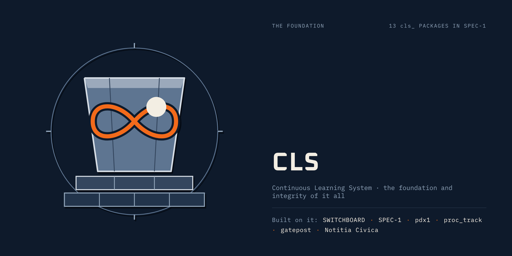

<p align="center"></p>

# CLS-1000

The public site for the CLS-1000 project family, built with [Astro](https://astro.build) and served at https://cls-1000.github.io/.

```bash
npm install
npm run dev      # local preview at http://localhost:4321
npm run build    # static site in dist/
```

- Project text: `src/data/projects.ts`
- Page layout: `src/pages/index.astro`
- Colors and spacing: `src/styles/global.css`

Every push to `main` builds and deploys the site through GitHub Actions, and a daily rebuild picks up new Notitia Civica stories from the newsroom feed.
